# CH32V003

<!-- TOC -->

- [Thông số](#thông-số)
    - [Bảng so sánh thông số kỹ thuật Hardware Specs](#bảng-so-sánh-thông-số-kỹ-thuật-hardware-specs)
    - [Bảng so sánh đặc điểm bo mạch & Trải nghiệm thực tế](#bảng-so-sánh-đặc-điểm-bo-mạch--trải-nghiệm-thực-tế)
- [Sơ đồ nguyên lý](#sơ-đồ-nguyên-lý)
- [Demo](#demo)
- [Sử dụng thiết bị WCH-LinkE](#sử-dụng-thiết-bị-wch-linke)
    - [Cài đặt công cụ](#cài-đặt-công-cụ)
    - [Kết nối WCH-LinkE với board](#kết-nối-wch-linke-với-board)
    - [Kết nối công cụ](#kết-nối-công-cụ)
    - [Xóa toàn bộ Flash áp dụng khi MCU bị khóa](#xóa-toàn-bộ-flash-áp-dụng-khi-mcu-bị-khóa)
    - [Mở khóa MCU](#mở-khóa-mcu)
    - [Nạp firmware với hex file](#nạp-firmware-với-hex-file)
- [Nạp mã nguồn từ ArduinoIDE](#nạp-mã-nguồn-từ-arduinoide)
- [Nạp mã nguồn với PlatformIO](#nạp-mã-nguồn-với-platformio)
- [Mua sắm](#mua-sắm)
- [Tham khảo](#tham-khảo)

<!-- /TOC -->

## Thông số

CH32V003

| Hàng chân trái | Hàng chân phải |
| -- | -- |
| PC5 | PC4 |
| PC6 | PC3 |
| PC7 | PC2 |
| PD0 | PC1 |
| PD1=SWDIO | PC0 |
| PD2 | PA2 |
| PD3 | PA1 |
| PD4 | RX  |
| PD7 | TX  |
|  V  |  V  |
|  G  |  G  |

CHV003 thuần:\
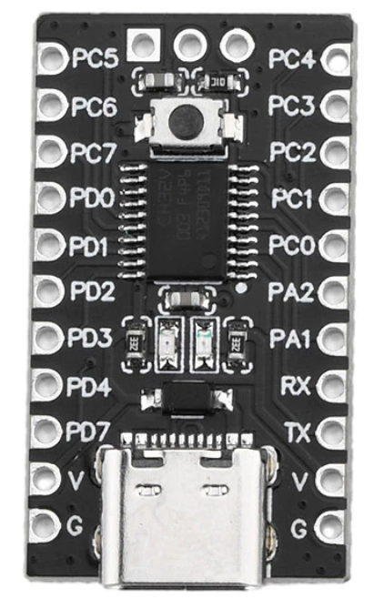
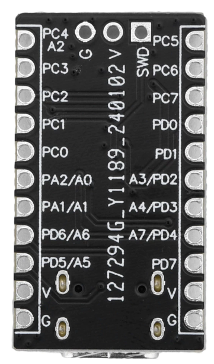

twen32 CHV003 với flash nhiều hơn:
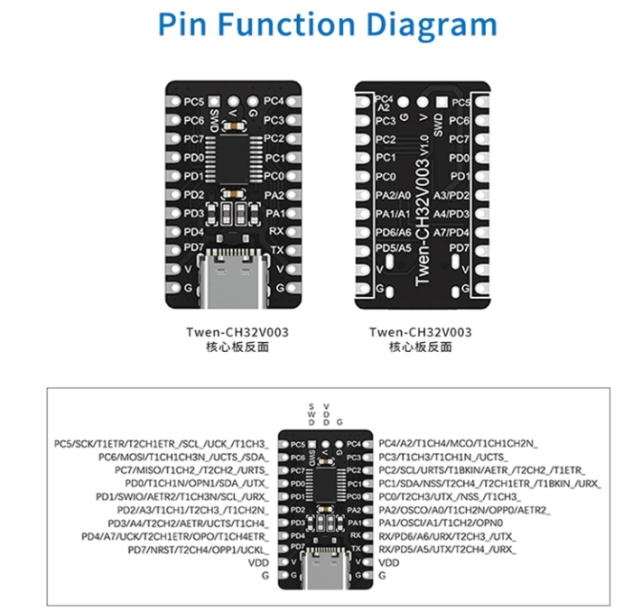

- được thiết kế dựa trên lõi [RISC-V2A 32-bit Qingke V2A](https://www.wch-ic.com/products/CH32V003.html)
- Điện áp vào: <span style="color: red;"> :imp: 3.3 / 5V</span>
- Tần số chính: 48MHz
- 1 timer đa năng 16 bit
- 1 timer nâng cao 16 bit 
- 1 giao tiếp USART
- 1 giao tiếp IIC
- 1 giao tiếp SPI
- 18 cổng I/O
- Kích thước: 31m * 18mm
- 1 Omp làm nhiệm vụ khuếch đại và so sánh = tín hiệu (liên quan tới chức năng ADC)
- 1 Timer cơ sở hệ thống 32 bit SysTick để tạo độ trễ (delay(), millis()).
- 2 WatchDog

Giao diện gỡ lỗi dòng đơn nối tiếp
Thời gian ADV / GP: 1 / 1

Đơn vị ADC / CH: 1 / 8

Và các tính năng khác như:

- Interrupt/Ngắt lồng chỉ tối đa 2 mức.
- Gỡ lỗi dòng đơn
- 2 chế độ năng lượng thấp: Sleep, Standby
- Đặt lại bật / tắt nguồn, máy dò điện áp có thể lập trình
- Mỗi MCU có một id định dạnh gồm 64 bit. [Xem cách đọc thông số này](https://pallavaggarwal.in/2023/09/25/ch32v003-programming-read-unique-id/)

### 1. Bảng so sánh thông số kỹ thuật (Hardware Specs)

| Thông số | CH32V003 Thuần (Tiêu chuẩn WCH) | CH32V003 trên bo TWen32 |
| :--- | :--- | :--- |
| **Tần số thạch anh (Clock)** | 48 MHz | 48 MHz |
| **Bộ nhớ Flash (Gốc / Thực tế)** | 16 KB | 64 KB *(Phần cứng thực tế tích hợp)* |
| **Bộ nhớ SRAM (Gốc / Thực tế)** | 2 KB | 8 KB *(Phần cứng thực tế tích hợp)* |
| **Điện áp hoạt động** | 3.3V / 5.0V | 3.3V / 5.0V |
| **Chuẩn nạp / Debug** | 1-Wire SDI (`PD1`/SWDIO, `PD0`/SWCLK) | 1-Wire SDI (`PD1`/SWDIO, `PD0`/SWCLK) |
| **Giao tiếp ngoại vi** | USART (1), I2C (1), SPI (1) | USART (1), I2C (1), SPI (1) |
| **Kênh ADC** | 10-bit ADC (8 kênh) | 10-bit ADC (8 kênh) |
| **Timer / PWM** | 1x Advanced Timer, 1x General Timer | 1x Advanced Timer, 1x General Timer |

---

### 2. Bảng so sánh đặc điểm bo mạch & Trải nghiệm thực tế

| Đặc điểm thiết kế | Bo CH32V003 Mini (Loại có nút bấm) | Bo TWen32F003 (Bo đen không nút) |
| :--- | :--- | :--- |
| **Nút bấm Reset / Boot** | **Có** (Có nút Reset cứng trên bo) | **Không** (Loại bỏ nút bấm cơ) |
| **Chân Breakout NRST** | Có đưa chân NRST ra hàng Pin | Không đưa chân NRST ra hàng Pin |
| **Giao tiếp USB Type-C** | Chỉ cấp nguồn (Không có USB-UART) | Chỉ cấp nguồn (Không có USB-UART) |
| **Tình trạng cờ bảo vệ (ROP)** | Thường tắt (Nạp dễ dàng ngay từ đầu) | Thường **bật sẵn** hoặc bị kẹt chân PD1 |
| **Thao tác xử lý khi bị khóa SDI** | Bấm giữ nút Reset cứng khi cắm nạp | Bắt buộc dùng mẹo **kẹp nguồn/quẹt VCC** (Cold Power-Cycle) |
| **Cấu hình Compiler (PlatformIO)** | Sử dụng mặc định `board = generic_CH32V003F4P6` | Cần chỉnh Linker Script để mở rộng lên 64K Flash / 8K RAM |

## Sơ đồ nguyên lý


Chi tiết xem ở đây <https://www.wch-ic.com/products/CH32V003.html>

## Demo

1. [Đọc đinh danh 64-bit của mỗi MCU](https://pallavaggarwal.in/2023/09/25/ch32v003-programming-read-unique-id/)
2. [CH32V003: GPIO as Output](https://pallavaggarwal.in/2023/09/21/ch32v003-programming-gpio-as-output/)
3. [CH32V003: GPIO as Input (Polling, Interrupt)](https://pallavaggarwal.in/2023/09/21/ch32v003-gpio-input-polling-interrupt/)
4. [CH32V003: UART Transmit / Receive data](https://pallavaggarwal.in/2023/09/23/ch32v003-programming-uart/)
5. [CH32V003: PWM output](https://pallavaggarwal.in/2023/09/23/ch32v003-programming-pwm-output/)
6. CH32V003: How to use an ADC
7. [CH32V003: How to use I2C](https://pallavaggarwal.in/2023/10/05/ch32v003-programming-i2c-eeprom/)
8. CH32V003: How to use SPI
9. [CH32V003: Timer based Periodic Interrupt](https://pallavaggarwal.in/2023/10/01/ch32v003-programming-timer-interrupt/)

## Sử dụng thiết bị WCH-LinkE

### Cài đặt công cụ

1. Tải về cồng cụ <https://www.wch.cn/downloads/file/418.html?time=2025-01-29%2000:40:51&code=s1HwvyGrvKvxJQz9lHAZEeXXXnaVCHatzQX7yitg>
2. Giải nén thư mục\
    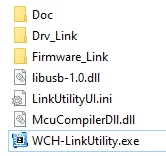
3. Cắm thiết bị WCH-LinkE vào cổng USB
4. Mở **Device Management**. Kiểm tra xem thiết bị có được nhận driver đúng như trong ảnh không?\
   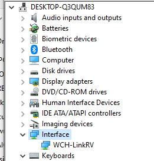\
   Nếu không, vào cài driverc **WCH-Utility\Drv_Link\WCHLinkDrv_WHQL_S.exe**

### Kết nối WCH-LinkE với board

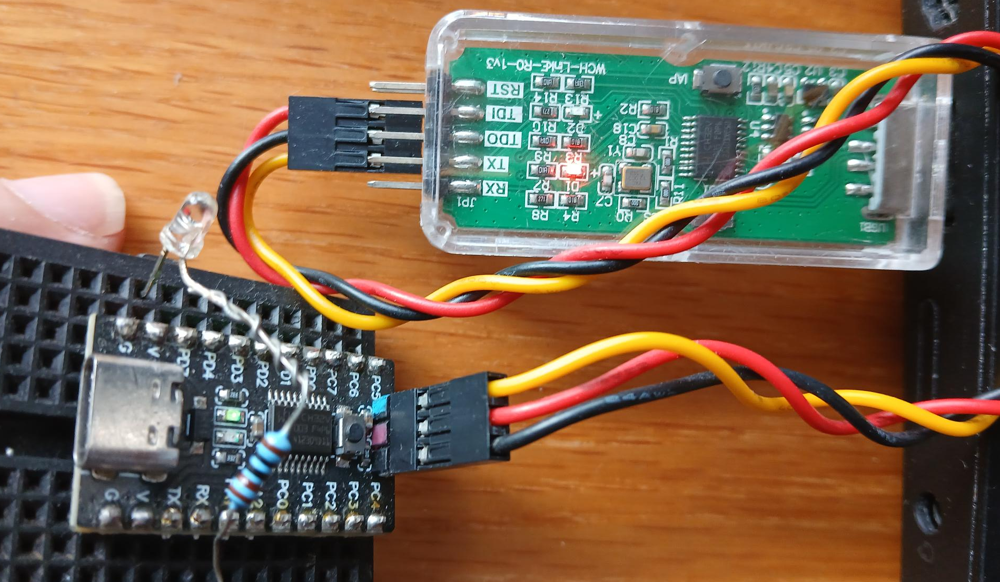
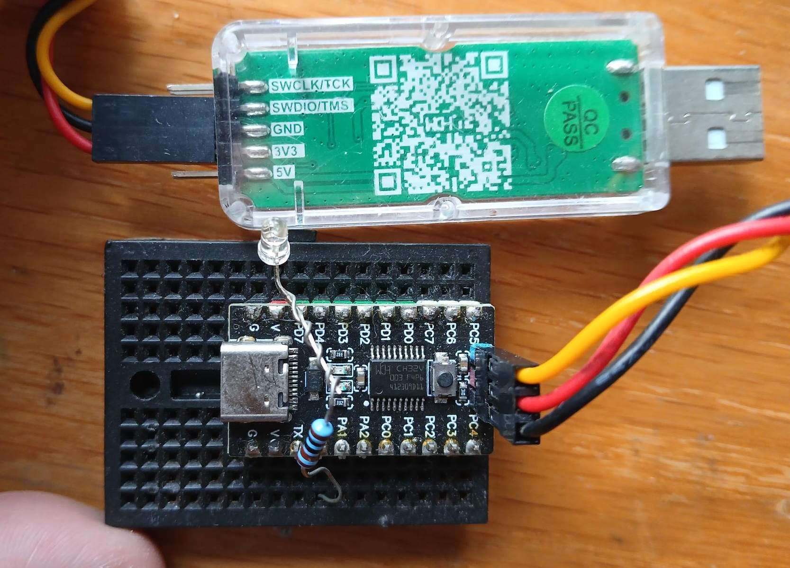

### Kết nối công cụ

1. Cài đặt và chạy tool WCH-Utility\
    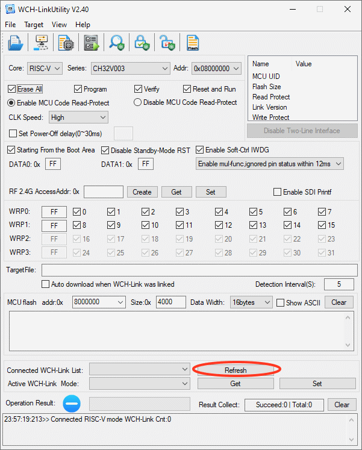
2. Trên WCH-Utility, ở thanh menu, bấm **Target/Connect WCH-Link** để thực hiện việc kết nối phần mềm **WCH-Utility** và công cụ debug **WCH-eLink**. Hộp messagebox ở cuối giao diện phải hiện ra thông báo.

    ```text
    Succeed to connect with WCH-Link!
    ```

3. Bấm nút **Refresh**. Sau đó, cấu hình chế độ hoạt động của WCH-ELink là làm việc với Risc-V như sau:
    - **Connected WCH-Link List** = RISC-V Link (#1)
    - **Active WCH-Link mode** = WCH-LinkRV

    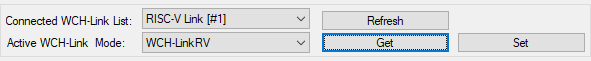

> WCH-LinkE có 2 mode hoạt động tương ứng với 2 dòng MCU theo kiến trúc `RISC-V` và `ARM`. Vì vậy cần chuyển mode để phù hợp.

### Xóa toàn bộ Flash (áp dụng khi MCU bị khóa)

Mô tả: trên board `TWen32`, nhà sản xuất thường nạp sẵn một bản Firmware test/Bootloader gốc. Bản Firmware này có 2 đặc điểm gây kẹt WCH-LinkE: Chân PD1 (SWDIO) bị cướp chức năng, hoặc Chế độ Power-Saving (Sleep) làm tắt clock của giao diện SWD/SDI.

Giải pháp xóa toàn bộ Flash với Cold Reset Power-Cycle:

1. Ngắt hờ cụm dây nối WCH-LinkE với board.\
   [](https://youtube.com/shorts/kKoX07suC8M)
2. Trên phần mềm WCH-LinkUtility, bấm **Tools/Erase Chip** (hoặc tốt nhất là bấm phím F9 liên tục).\
    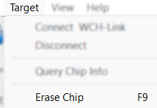
3. Cắm lại cụm dây 1-wire nối WCH-LinkE với board liên tục như trong video,

Ngay lập tức cắm lại dây nguồn 3V3 vào bo TWen32 trong vòng 0.5 giây. Việc cấp nguồn đột ngột sẽ buộc chip thực thi chuỗi khởi động lại và WCH-LinkE sẽ chộp lấy giao diện SDI trước khi code mẫu trong chip kịp chạy.

### Mở khóa MCU

- Bấm **Target / Disable Chip Code-Protect**\
   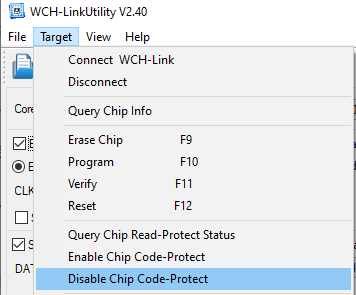 \
   Có thể xem thêm thông tin phụ như:
  - Bấm **Target / Query Chip Info**\
    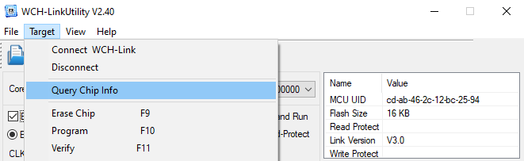

Hình ảnh cuôi cùng như sau:\
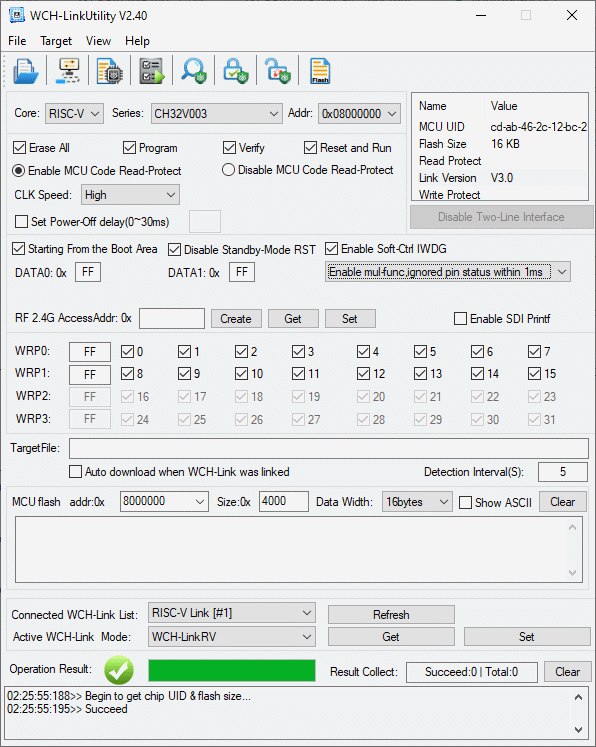

### Nạp firmware với hex file

1. Giả định đã có hex file bằng các công cụ như `ArduinoIDE`, `PlatformIO`, etc.
2. Mở **WCH-Utility**
3. Bám **File/Open Firmware** (hoặc **Alt+F1**) và trỏ với file hex.\
   Hộp **Target File** phải hiện thông tin đúng như đường dẫn đã nhập.\
   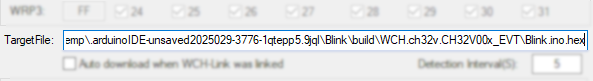
4. Bấm nút  **Execute Checked Operation** (hoặc **Alt+F4**)

> KHÔNG bấm *Target/Program (Alt+F10)* vì tính năng này không phải là nạp firmware.\
> File hex luôn được đọc lại refresh vào thời điểm bấm nút nạp. Vì vậy không cần phải thực hiện lại thao tác trỏ vào file hex mới.

## Nạp mã nguồn từ ArduinoIDE

1. Kết nối dây để nạp code

    | Twen32 | WCH-eLink|
    | -- | -- |
    | GND | GND |
    | V   | 3v3 |
    | PD1 | SMDIO/TMS |

2. Nối linh kiện để demo
    - Led nối giữa chân **G** và **PC0**

3. Trong ArduinoIDE, thêm loại **Board Manager URL** mới:

    ```json
    https://github.com/openwch/board_manager_files/raw/main/package_ch32v_index.json
    ```

4. Cài đặt board mới (**CH32 MCU EVT boards**)\
   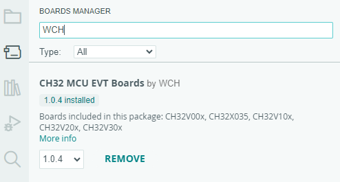

5. Chọn board **CH32V00x** và cổng **COM**\
   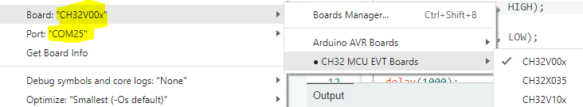

6. Tạo dự án mới và copy đoạn code như sau

    ```C
    #define MYLED PC0
    void setup() {
        pinMode(MYLED, OUTPUT); 
    }
    void loop() {
        digitalWrite(MYLED, LOW);
        delay(100);
        digitalWrite(MYLED, HIGH);
        delay(1000);
    }
    ```

7. Bấm **Upload** như các dự án khác.\
   Done.
   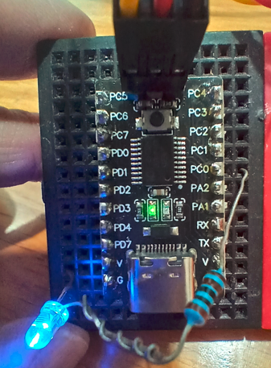
    > Không cần bấm bất cứ nút nào trước hoặc sau khi nạp code. Chương trình được nạp và tự chạy luôn.

## Nạp mã nguồn với PlatformIO

1. Khai báo board trong ```platformio.ini``` như sau

   ```ini
   [env:ch32v003f4p6_evt_r0]
    platform = https://github.com/Community-PIO-CH32V/platform-ch32v.git
    board = ch32v003f4p6_evt_r0
    framework = arduino

    upload_protocol = wch-link
    monitor_speed = 115200

    build_flags = 
        -fno-strict-aliasing
        -Os
        -ffunction-sections
        -fdata-sections
        -Wl,--gc-sections
   ```

## Mua sắm

> PHẢI mua loại có nút bấm. [Loại không có nút bấm](https://shopee.vn/B%E1%BA%A3ng-M%E1%BA%A1Ch-Chuy%E1%BB%83N-%C4%90%E1%BB%95I-%C4%90i%E1%BB%87N-Dusur-TWen32F003-RISC-V-Processor-CH32V003F4P6-i.1067101419.24859146770) không thể nào detect được bằng công cụ WCH-eLink.
- [Shopee](https://shopee.vn/Pcbfun-1-5-C%C3%81I-CH32V003F4P6-B%E1%BA%A3ng-ph%C3%A1t-tri%E1%BB%83n-l%C3%B5i-CH32V003-M%C3%B4-%C4%91un-vi-%C4%91i%E1%BB%81u-khi%E1%BB%83n-RISC-V-B%E1%BB%99-x%E1%BB%AD-l%C3%BD-TYPE-C-Giao-di%E1%BB%87n-i.213820428.24768030220)
- [AliExpress](https://vi.aliexpress.com/item/1005005221751705.html?gatewayAdapt=glo2vnm)

## Tham khảo

<https://www.hackster.io/patrick-fitzgerald2/program-ch32v003-risc-v-with-arduino-ide-135f6f>